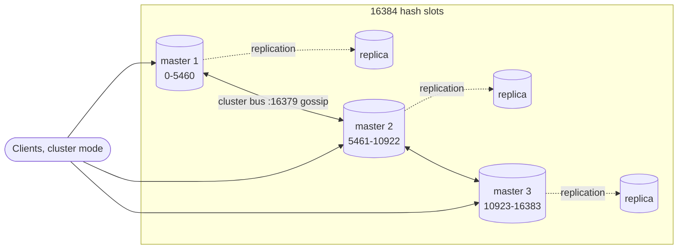

# redis-cluster-ansible-helm

Two ways I deploy a **Redis Cluster (3 masters + 3 replicas)**, both from real work:

| Folder | Target | What it is |
|---|---|---|
| [`playbook/`](playbook) | 6 VMs, Oracle Linux 9, **air-gapped**, Redis 6.2 RPM | Ansible playbook sized for ~100k client connections |
| [`redis-helm/`](redis-helm) | Kubernetes / OpenShift, `bitnami/redis` image | Helm chart that fixes stale node IPs after pod restarts |



| Port | Use |
|---|---|
| 6379 | Client traffic |
| 16379 | Cluster bus (gossip, failover votes). Must be open between all nodes |

## 1. Ansible playbook (VMs, air-gapped)

Lab inventory: `redis1..redis6` = `192.168.61.11-16` (`playbook/hosts.ini`).

```bash
cd playbook
cp /path/to/redis-6.2.20-2.el9_7.x86_64.rpm artifacts/    # RPM is not in git
ansible-playbook -i hosts.ini site.yml                   # add -e redis_serial=1 on a live cluster
ansible-playbook -i hosts.ini create-cluster.yml          # skipped if the cluster already exists
ansible-playbook -i hosts.ini check.yml
```

What `site.yml` does, in order: `/etc/hosts`, firewalld off, SELinux permissive, THP off (systemd
unit ordered before `redis.service`), sysctl, RPM install/upgrade only when the version differs,
templated `redis.conf`, systemd drop-in, start. Restarts happen **only** through handlers when
something changed, and each restart waits for `PONG` and then `cluster_state:ok` before the next
host (`serial`).

### Design decisions

| Decision | Why |
|---|---|
| `maxmemory` = smallest node's **physical** RAM x 0.6 | Slots are spread evenly, so the smallest node is the limit. 40% left for fork copy-on-write (AOF rewrite), client buffers, OS. Swap is not counted. |
| `io-threads` from vCPU (`<4` → 1, else 3/4, max 8) | Threads help network I/O at high connection counts. Above 8 there is no gain. |
| AOF `everysec` only, RDB off (`save ""`) | One fork-based persistence instead of two. At most ~1s of writes lost per node crash. |
| `vm.overcommit_memory = 1`, THP off, `swappiness = 1` | Redis docs requirements: fork must not fail, THP causes latency spikes on CoW, swap kills latency. |
| `repl-diskless-sync yes`, `repl-backlog-size 512mb`, replica buffer `2gb 1gb 300` | Avoid full-resync loops when a replica falls behind for a moment. |
| `maxclients 120000`, `LimitNOFILE 131072`, `tcp-keepalive 60` | ~100k devices + 20%. Each idle conn costs ~20 KB (~2.4 GB/node), and that counts inside `maxmemory`. |
| `cluster-require-full-coverage no` | Losing one master's slots must not stop reads/writes on the other two thirds. |
| `TimeoutStartSec=infinity` | Loading a large AOF takes longer than systemd's 90s default. systemd was killing Redis mid-load. |
| `REDISCLI_AUTH` env instead of `redis-cli -a` | The password does not show up in `ps`. |
| `rpm -Uvh` only when NVR differs | Re-running the playbook is a no-op on a healthy cluster. |

### Bugs I fixed in the earlier version of this playbook

- Generated config had `- requirepass` / `- masterauth` (stray `- `), so Redis would not start.
- IPs in `/etc/hosts` and `create-cluster` were hard-coded and wrong. They now come from the inventory.
- `hosts: redis1` matched no host, so `create-cluster` and `check` silently did nothing.
- A second run failed, and every run restarted all 6 nodes at once.
- `check.yml` had no password.

## 2. Helm chart (Kubernetes)

See [`redis-helm/README.md`](redis-helm/README.md) for the full procedure (adopting a live
StatefulSet into Helm, rollback).

**The incident behind it.** Services started failing with `QueryTimeoutException: Redis
command timed out` on about one third of keys, while `cluster_state:ok` on every node. One master
pod had restarted and got a new IP (`10.244.1.199 → 10.244.0.30`), but the `myself` line in its
`nodes.conf` still had the old IP. Redis only re-learns its own address on a `MEET`. The Lettuce
client pulled the topology from that node and routed its slots to a dead IP.

The `bitnami/redis` image (unlike `bitnami/redis-cluster`) has no step for this. The chart adds it:

| Change | Effect |
|---|---|
| `--cluster-announce-ip $POD_IP` | Node always advertises the pod's real IP |
| Rewrite the `myself` line in `nodes.conf` at start | No stale own-IP after a restart |
| Rewrite peer IPs from a saved host→IP map + headless DNS | Whole cluster restarting at once (all IPs change) still re-forms |
| `enableServiceLinks: false` | No `REDIS_PORT=tcp://...` env injected into the pod |
| `minReadySeconds: 20` + PDB `maxUnavailable: 1` | Rolling restart waits for failover before touching the next pod |
| `cluster-init` Job (post-install) | Runs `--cluster create` only when every node is empty |

## Verify

```bash
redis-cli -h 192.168.61.11 cluster info | grep -E 'cluster_state|cluster_slots_ok|cluster_known_nodes'
redis-cli --cluster check 192.168.61.11:6379
redis-cli -h 192.168.61.11 cluster nodes | awk '{print $2, $3}'   # every IP must be a live node
```

## Troubleshooting

| Symptom | Likely cause | Check |
|---|---|---|
| Timeouts on a subset of keys, `cluster_state:ok` | A node advertises a stale IP | `cluster nodes` on each node: does `myself` match the real IP? `CLUSTER MEET <new-ip> 6379` as hotfix |
| `CLUSTERDOWN` after one node failed | Its replica could not be promoted (both on one host, or cluster bus 16379 blocked) | `redis-cli --cluster check`, `nc -zv <node> 16379` |
| Redis killed during start | systemd start timeout while loading AOF | `journalctl -u redis`; drop-in sets `TimeoutStartSec=infinity` |
| `OOM command not allowed` | `maxmemory` reached with `noeviction`, or client buffers eat the budget | `info memory`, `info clients`, `client list` |
| Replica full-syncs in a loop | Backlog/output buffer too small for the write rate | `info replication`, log `psync ... backlog` |
| Latency spikes every few minutes | AOF rewrite fork with THP on, or swapping | `cat /sys/kernel/mm/transparent_hugepage/enabled`, `latency doctor` |

## Next steps

- Re-enable firewalld with only 6379/16379 open between nodes.
- Encrypt `redis_password` with `ansible-vault` (the value in `group_vars` is a lab placeholder).
- If Redis is the primary data store (not a cache), switch `allkeys-lru` → `noeviction`.
- Helm chart: add `requirepass`/`masterauth` from a Secret and a NetworkPolicy (it runs without a password today, like the cluster it adopted).
- Pub/Sub on a 6.2 cluster broadcasts to every node. Sharded pub/sub needs Redis 7+.
- Not yet run on fresh VMs from this repo: playbooks pass `--syntax-check`, the chart passes `helm lint`.

## License

[MIT](LICENSE)
